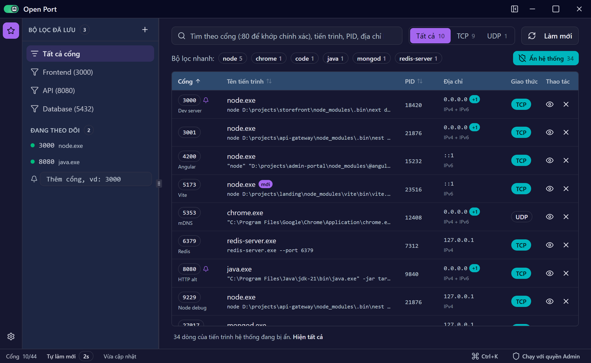

# Open Port

Ứng dụng desktop cho Windows giúp xem cổng mạng nào đang bị chiếm, bởi tiến trình nào, và giải phóng chúng chỉ với vài thao tác. Xây dựng bằng Tauri 2, React, TypeScript và Tailwind.

## Tải về

- Trang phát hành: https://github.com/hoan02/open-port/releases
- Chọn bản mới nhất, tải bộ cài `.exe` (NSIS) hoặc `.msi`. File `open-port.exe` là bản chạy trực tiếp, không cần cài.
- Hỗ trợ Windows 10/11 (x64).

## Tính năng

### Xem cổng đang dùng
- Danh sách thời gian thực các cổng **TCP đang lắng nghe** và **UDP đang bind**; IPv4 và IPv6 của cùng một socket được gộp thành một dòng.
- Mỗi dòng có: địa chỉ bind, PID, tên tiến trình, **dòng lệnh** (phân biệt nhiều `node.exe` như `vite`, `ng serve`, `nest start`…), **tên dịch vụ** bên trong `svchost.exe` và tên cổng phổ biến (PostgreSQL, Redis, Vite…).
- Cổng vừa mở được đánh dấu "mới"; status bar cho biết lần cập nhật gần nhất.

### Lọc và tìm kiếm
- **Ẩn hệ thống**: ẩn dịch vụ và tiến trình của hệ điều hành chỉ với một nút. Nếu kết quả tìm kiếm khớp với dòng đang bị ẩn, app sẽ báo để bạn không bỏ sót.
- Lọc nhanh TCP/UDP và theo tiến trình đang chạy.
- Tìm theo cổng, tiến trình, dòng lệnh, PID hoặc địa chỉ. Gõ `:3000` để khớp **chính xác** cổng 3000.
- Lưu bộ lọc hay dùng ở sidebar; sắp xếp theo cổng, tiến trình hoặc PID.

### Thao tác
- **Kết thúc tiến trình**, có tuỳ chọn kết thúc cả tiến trình con (giống `taskkill /T`, hữu ích với dev server chạy qua npm/yarn). Hộp thoại xác nhận liệt kê mọi cổng sẽ được giải phóng.
- Menu chuột phải: mở `http://localhost:<port>` trong trình duyệt, mở thư mục chứa file chạy, sao chép cổng/PID/địa chỉ/dòng lệnh/đường dẫn.
- **Bảng lệnh** (`Ctrl+K`): gõ `kill 3000` hoặc tên tiến trình để thao tác nhanh.
- Khi bị từ chối quyền, có nút **Chạy với quyền Admin** ngay trong thông báo lỗi.

### Theo dõi cổng
- Thêm cổng vào mục *Đang theo dõi* (ở sidebar hoặc menu chuột phải) để nhận **thông báo Windows** khi cổng bị chiếm hoặc được giải phóng, kể cả khi app đang ẩn dưới khay hệ thống.
- Tuỳ chọn *Đóng xuống khay hệ thống* trong phần cài đặt.

### Khác
- Tự làm mới (1–30 giây), tạm dừng khi chuột đang ở trên danh sách để các dòng không bị xê dịch ngay lúc bạn bấm.
- Giao diện sáng/tối, tiếng Việt/tiếng Anh; nhớ kích thước và vị trí cửa sổ; chỉ chạy một bản cùng lúc.

## Phím tắt

| Phím | Tác dụng |
| --- | --- |
| `Ctrl+K` | Mở bảng lệnh |
| `Ctrl+F` | Tìm kiếm |
| `F5` | Làm mới |
| `↑` / `↓`, `Home` / `End` | Chọn dòng |
| `Enter` | Xem chi tiết dòng đang chọn |
| `Delete` | Kết thúc tiến trình của dòng đang chọn |
| `Esc` (trong ô tìm kiếm) | Xoá tìm kiếm |

## Lưu ý

- Một số tiến trình (dịch vụ, tiến trình của người dùng khác) chỉ kết thúc được khi chạy app với quyền Administrator.
- Database cài dạng Windows service (PostgreSQL, MySQL, SQL Server…) được tính là tiến trình hệ thống, nên sẽ bị ẩn khi bật *Ẩn hệ thống*.
- App không gửi dữ liệu ra ngoài; mọi thông tin được đọc trực tiếp từ Windows.

## Phát triển

### Yêu cầu

- Windows 10/11
- Node.js 20+ và npm
- Rust (toolchain stable)

### Lệnh

```bash
npm install
```

```bash
npm run tauri:dev
```

| Lệnh | Tác dụng |
| --- | --- |
| `npm run tauri:dev` | Chạy app Tauri với live reload |
| `npm run dev` | Chỉ chạy giao diện trên Vite (không có dữ liệu cổng vì thiếu backend Tauri) |
| `npm run build` | Kiểm tra kiểu và build giao diện |
| `npm run tauri:build` | Đóng gói bộ cài (cần khoá ký, xem bên dưới) |
| `cargo test --lib` (trong `src-tauri`) | Chạy test backend |

### Cấu trúc

```
src/                    Giao diện React
  components/features/  Bảng cổng, tìm kiếm, hộp thoại, bảng lệnh
  components/layout/    Title bar, sidebar, status bar, cài đặt
  hooks/                Tải dữ liệu, tự làm mới, thao tác, tích hợp desktop
  i18n/locales/         Bản dịch vi / en
src-tauri/src/
  net.rs                Đọc bảng TCP/UDP (IP Helper API)
  process.rs            Thông tin tiến trình, dịch vụ, kết thúc tiến trình
  elevation.rs          Kiểm tra và chạy lại với quyền Administrator
  tray.rs               Icon khay hệ thống
  watch.rs              Theo dõi cổng và gửi thông báo
  lib.rs                Tauri commands và khởi tạo plugin
```

### Đóng gói

Bản build được ký để phục vụ cập nhật tự động, nên `tauri build` cần khoá ký trong biến môi trường:

```powershell
$env:TAURI_SIGNING_PRIVATE_KEY = Get-Content -Raw "$HOME\.tauri\open-port.key"
```

```powershell
$env:TAURI_SIGNING_PRIVATE_KEY_PASSWORD = Get-Content -Raw "$HOME\.tauri\open-port.key.password"
```

```powershell
npm run tauri:build
```

Bộ cài nằm tại `src-tauri/target/release/bundle/` (`msi/`, `nsis/`), kèm file chữ ký `.sig`.

## CI/CD

- **CI** (`.github/workflows/ci.yml`): mỗi pull request và mỗi lần push lên `main` sẽ build giao diện và chạy test backend.
- **Release** (`.github/workflows/release.yml`): khi push tag `vX.Y.Z`, workflow kiểm tra version khớp tag, build, ký và tạo GitHub Release kèm bộ cài, file chạy trực tiếp và `latest.json` cho cập nhật tự động.

Quy trình phát hành và cách cấu hình khoá ký: xem [RELEASE_TAG.md](RELEASE_TAG.md).
